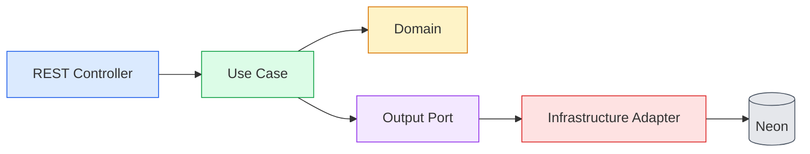
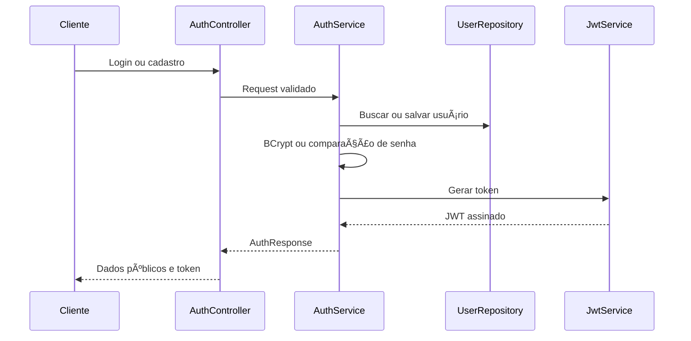
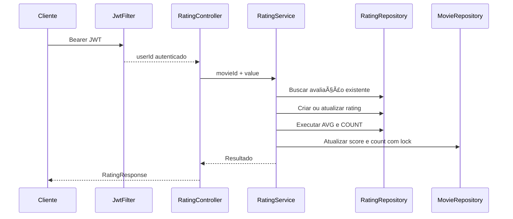

# 🎬 GitCine — Contexto Atual do Backend

Documento atualizado em **22/11/2026** com o estado real da refatoração, decisões técnicas e pendências para entrega.

---

## 📌 Visão geral

GitCine é um catálogo de filmes com autenticação, autorização por perfil e avaliações por usuário.

| Tecnologia | Situação |
|---|---|
| Java 25 | Configurado |
| Spring Boot 4.1.2 | Configurado |
| Spring Web | Implementado |
| Spring Data JPA | Implementado |
| Spring Security | Implementado |
| JJWT | Implementado |
| BCrypt | Implementado |
| PostgreSQL / Neon | Banco principal configurado por variáveis de ambiente |
| SpringDoc / OpenAPI | Configurado |
| JaCoCo | Configurado |
| Testcontainers PostgreSQL e ArchUnit | Dependências disponíveis, testes pendentes |

### Objetivos da refatoração

- separar domínio, aplicação e infraestrutura;
- autenticar usuários com JWT;
- identificar o usuário pelo `userId` presente no subject;
- separar `ROLE_USER` e `ROLE_ADMIN`;
- impedir avaliação duplicada por usuário e filme;
- recalcular média e quantidade de avaliações;
- manter o backend independentemente do schema do Neon;
- impedir que regras fiquem nos controllers.

---

## 🧱 Arquitetura hexagonal



### Estrutura ativa

```text
com.dsmovie
├── domain
│   ├── model
│   ├── service
│   ├── validation
│   └── exception
├── application
│   ├── dto
│   ├── mapper
│   ├── port/in
│   ├── port/out
│   └── useCase
└── infrastructure
    ├── config
    ├── exception
    ├── persistence
    │   ├── entity
    │   ├── repository
    │   └── adapter
    ├── rest
    └── security
```

O backend legado em `com.devsuperior.dsmovie` foi removido.

---

## 🔐 Autenticação JWT

### Fluxo



### Token

```text
subject (sub) = userId
email          = email normalizado
name           = nome do usuário
role           = USER ou ADMIN
issuer         = gitcine-backend
expiration     = 2 horas
```

JWT padrão:

```yaml
jwt:
  secret: ${JWT_SECRET}
  expiration: ${JWT_EXPIRATION:7200000}
  issuer: ${JWT_ISSUER:gitcine-backend}
```

### Segurança

- senha criptografada com BCrypt;
- token assinado com segredo válido;
- issuer validado no parser;
- filtro JWT limpa o contexto antes de autenticar;
- requisição protegida usa o `userId` do subject;
- credenciais nunca são devolvidas pela resposta;
- cadastro público sempre cria `ROLE_USER`;
- role não pode ser informada no cadastro público;
- campos JSON desconhecidos respondem `400`;
- JWT inválido ou expirado responde `401`;
- ausência de role administrativa responde `403`.

> A expiração padrão foi reduzida de 24 horas para 2 horas. Sem refresh token, o frontend deve redirecionar o usuário ao login após `401`.

---

## 👥 Roles e permissões

O schema preparado usa:

```text
tb_role
├── id
└── authority

tb_user_role
├── user_id
└── role_id
```

Autoridades existentes:

- `ROLE_USER`;
- `ROLE_ADMIN`.

Cada usuário deve possuir uma única role no modelo atual.

| Permissão | USER | ADMIN | Público |
|---|:---:|:---:|:---:|
| Login e cadastro | ✓ | ✓ | ✓ |
| Consultar filmes | ✓ | ✓ | ✓ |
| Avaliar ou atualizar nota | ✓ | ✓ | — |
| Sugerir filme por email | ✓ | ✓ | — |
| Cadastrar filme | — | ✓ | — |

### Convencões

| Lugar | Valor |
|---|---|
| Banco: `tb_role.authority` | `ROLE_USER` / `ROLE_ADMIN` |
| Claim do JWT: `role` | `USER` / `ADMIN` |
| Spring Security | `ROLE_USER` / `ROLE_ADMIN` |

### Estado do schema Neon

- `tb_user` contém `name`, `email` e `password`;
- `password` aceita hashes BCrypt de até 255 caracteres;
- `tb_role` contém `ROLE_USER` e `ROLE_ADMIN`;
- `tb_user_role` vincula usuário e role;
- Maria possui `ROLE_ADMIN`;
- os demais usuários possuem `ROLE_USER`;
- as foreign keys de usuários, roles, filmes e avaliações estão aplicadas;
- resta validar essas estruturas pelo startup real da aplicação.

---

## ⭐ Avaliação de filmes



### Regras implementadas no código

- notas válidas entre `1.0` e `5.0`;
- chave composta por `movie_id + user_id`;
- lock pessimista ao carregar o filme;
- média calculada por `AVG(r.value)`;
- quantidade calculada por `COUNT(r)`;
- recálculo dentro da transação;
- atualização da nota mantém o `count`;
- primeira avaliação adiciona ao `count`;
- `userId` vem do JWT, não do body.

> O recálculo está implementado, mas não está concluído até o teste concorrente passar contra PostgreSQL real.

### Endpoint

```http
POST /api/ratings
Authorization: Bearer <jwt>
Content-Type: application/json

{
  "movieId": 1,
  "value": 4.5
}
```

---

## 🎬 Funcionalidades atuais

### Filmes

- listagem pública paginada;
- busca pública por ID;
- cadastro administrativa;
- título normalizado;
- URL de imagem validada;
- duplicidade de título rejeitada;
- `score = 0.0` e `count = 0` em novos filmes.

### Avaliações

- criação ou atualização;
- chave composta;
- validação de nota;
- recálculo agregado;
- lock pessimista do filme;
- proteção por JWT.

### Propostas de filme

- endpoint autenticado;
- título e mensagem;
- envio assíncrono por SMTP;
- falha de email tratada com log;
- resposta `202 Accepted`.

### Administração

```http
POST /api/admin/movies
Authorization: Bearer <jwt-admin>
```

Somente usuários com `ROLE_ADMIN` acessam `/api/admin/**`.

---

## 🎯 Endpoints REST

| Método | Endpoint | Acesso |
|---|---|---|
| POST | `/api/auth/register` | Público |
| POST | `/api/auth/login` | Público |
| GET | `/api/movies` | Público |
| GET | `/api/movies/{id}` | Público |
| POST | `/api/ratings` | JWT |
| POST | `/api/movie-requests` | JWT |
| POST | `/api/admin/movies` | JWT + ADMIN |
| GET | `/actuator/health` | Público |
| GET | `/swagger-ui.html` | Público em desenvolvimento |
| GET | `/v3/api-docs` | Público em desenvolvimento |

---

## 🗄️ Banco PostgreSQL/Neon

### Estrutura usada

| Entidade JPA | Tabela | Chave |
|---|---|---|
| `UserEntity` | `tb_user` | `id` |
| `RoleEntity` | `tb_role` | `id` |
| `UserEntity.roles` | `tb_user_role` | `user_id + role_id` |
| `MovieEntity` | `tb_movie` | `id` |
| `RatingEntity` | `tb_score` | `movie_id + user_id` |

### Decisões fechadas

- o banco vive no Neon;
- o backend não cria tabelas;
- o backend não cria schemas;
- o backend não executa migrations;
- não existe Flyway/Liquibase no projeto;
- `prod` usa `ddl-auto: validate`;
- o banco principal é o Neon;
- testes não precisam de banco embarcado;
- alterações estruturais são feitas manualmente no Neon;

### Dados já existentes no script

- filmes iniciais;
- usuários iniciais;
- usuários e roles;
- avaliações iniciais;
- foreign keys entre filmes, usuários e avaliações.

---

## ⚙️ Configuração por ambiente

### Desenvolvimento

```yaml
spring:
  datasource:
    url: ${DB_URL}
    username: ${DB_USERNAME}
    password: ${DB_PASSWORD}
  jpa:
    hibernate:
      ddl-auto: validate
```

### Testes

- não utilizar banco embarcado;
- unitários: mocks e objetos puros;
- integração: PostgreSQL/Testcontainers;
- segurança: MockMvc com Spring Security;
- concorrência: PostgreSQL real, com lock e agregação;

### Produção

- PostgreSQL/Neon;
- `ddl-auto: validate`;
- Swagger desabilitado;
- JWT com 2 horas;
- secret JWT protegido por ambiente;
- máximo de 50 itens por página;
- Actuator limitado a `health` e `info`.

### Variáveis

```dotenv
DB_URL=jdbc:postgresql://host/neondb?sslmode=require
DB_USERNAME=usuario
DB_PASSWORD=senha
JWT_SECRET=secret-longo-e-aleatorio
JWT_EXPIRATION=7200000
JWT_ISSUER=gitcine-backend
APP_PROFILE=prod
CORS_ALLOWED_ORIGINS=https://frontend.example.com
SMTP_HOST=smtp.example.com
SMTP_PORT=587
SMTP_USERNAME=usuario
SMTP_PASSWORD=senha
```

Nomes, senhas e credenciais reais não devem aparecer em código, Markdown, logs ou Git.

---

## 🚨 Tratamento de erros

`GlobalExceptionHandler` padroniza os erros.

| Situação | HTTP |
|---|---:|
| Dados inválidos | 400 |
| Credencial ou token inválido | 401 |
| Role insuficiente | 403 |
| Usuário ou filme inexistente | 404 |
| Conflito ou duplicidade | 409 |
| Nota fora do intervalo | 422 |
| Erro interno | 500 |

A resposta não deve expor stack trace, SQL ou detalhes internos.

---

## 📚 Swagger

O Swagger está configurado com:

- título e descrição da API;
- Bearer JWT;
- security scheme `bearerAuth`;
- tags por domínio;
- schemas dos DTOs;
- parâmetros de paginação;
- respostas básicas.

URLs em desenvolvimento:

```text
/swagger-ui.html
/v3/api-docs
```

Em produção, Swagger e OpenAPI ficam desabilitados.

Ainda falta completar exemplos detalhados de cada resposta HTTP.

---

## ✅ Estado atual

### Concluído

- [x] arquitetura hexagonal básica;
- [x] Java 25 e Spring Boot 4.1.2;
- [x] cadastro, login e BCrypt;
- [x] JWT com issuer e 2 horas de expiração;
- [x] filtro JWT;
- [x] role persistida em JPA;
- [x] cadastro público fixado em `ROLE_USER`;
- [x] campos JSON desconhecidos rejeitados;
- [x] perfis `dev` e `prod`;
- [x] H2 removido de dependências e configurações;
- [x] endpoints públicos de filmes;
- [x] avaliação protegida;
- [x] cadastro administrativo;
- [x] proposta de filme por email;
- [x] lock pessimista do filme;
- [x] agregação SQL de média e quantidade;
- [x] CORS configurável;
- [x] Swagger básico;
- [x] Swagger desabilitado em produção;
- [x] Actuator reduzido;
- [x] Flyway removido;
- [x] backend legado removido;
- [x] compilação e testes Maven executados.

### Em validação

- [ ] compatibilidade real das entidades JPA com o schema aplicado;
- [ ] role ADMIN carregada do banco;
- [ ] cadastro e login contra Neon;
- [ ] avaliação contra Neon;
- [ ] atualização da mesma avaliação;
- [ ] score/count concorrentes;
- [ ] envio real de email;
- [ ] Swagger completo;
- [ ] integração frontend.

### Pendente

- [ ] testes de segurança com MockMvc;
- [ ] testes JWT: válido, expirado e adulterado;
- [ ] testes de roles;
- [ ] testes PostgreSQL/Testcontainers;
- [ ] teste concorrente de score/count;
- [ ] testes ArchUnit;
- [ ] pipeline CI/CD;
- [ ] deploy em nuvem.

---

## 🧪 Validação técnica realizada

Comandos executados:

```powershell
.\mvnw -q test
.\mvnw -q -DskipTests compile
```

Testes conhecidos:

- `AuthServiceTest`;
- `RatingDomainServiceTest`;
- `DsmovieApplicationTests`.

A implementação atual ainda não possui uma prova automatizada concorrente do score/count nem testes completos de segurança JWT.

Os testes unitários executados não inicializam banco embarcado. Os testes com Neon/PostgreSQL serão executados por integração separada.

---

## 🚀 Próximos passos

1. Configurar `DB_URL`, `DB_USERNAME`, `DB_PASSWORD` e `JWT_SECRET` no ambiente.
2. Iniciar o backend com `APP_PROFILE=prod`.
3. Validar o schema via `Hibernate validate` durante o startup.
4. Testar login dos usuários existentes no Neon.
5. Confirmar Maria com `ROLE_ADMIN` no JWT.
6. Confirmar os demais usuários com `ROLE_USER` no JWT.
7. Testar cadastro público; ele deve atribuir `ROLE_USER` automaticamente.
8. Testar avaliações criadas e atualizadas.
9. Testar concorrência real de score/count.
10. Testar rotas públicas, `401` e `403`.
11. Completar MockMvc e Testcontainers.
12. Completar Swagger e exemplos de erro.
13. Integrar frontend, CI e deploy.

---

## 🏁 Critério de conclusão

- [ ] schema compatível com as entidades JPA;
- [ ] cadastro funcionando;
- [ ] login funcionando;
- [ ] senha persistida com BCrypt;
- [ ] uma única role por usuário;
- [ ] Maria com `ROLE_ADMIN`;
- [ ] demais usuários com `ROLE_USER`;
- [ ] JWT válido autenticado;
- [ ] JWT expirado ou adulterado retorna `401`;
- [ ] usuário sem role administrativa recebe `403`;
- [ ] avaliação sem token é bloqueada;
- [ ] avaliação cria ou atualiza corretamente;
- [ ] não existe duplicidade por usuário e filme;
- [ ] score corresponde à média real;
- [ ] count corresponde ao total real;
- [ ] teste concorrente passa em PostgreSQL;
- [ ] admin cadastra filme;
- [ ] usuário envia proposta;
- [ ] credenciais são gerenciadas por ambiente ou secrets;
- [ ] Swagger está disponível somente onde configurado;
- [ ] testes passam;
- [ ] frontend integrado;
- [ ] CI/CD configurado;
- [ ] deploy concluído.